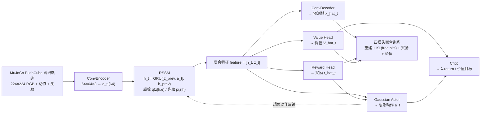

# vla-world-model-lab

**基于 Dreamer 范式的具身世界模型实验室** —— 从 MuJoCo 离线轨迹学习「图像 + 动作 → 隐状态 → 下一帧图像 / 奖励」的动力学模型，并在隐空间中训练想象策略，系统验证世界模型对样本效率与长程预测的作用。

> **项目边界**：本项目聚焦**算法层世界模型**——RSSM 动力学、多步开环想象、奖励 / 价值头与想象策略全链路，全部在 MuJoCo 仿真环境（PushCube-v0 推立方体）的离线轨迹上验证；**不涉及底层机器人控制**（电机驱动、实机部署、运动学 / 动力学求解均不在范围内）。

---

## 一、项目简介

纯视觉强化学习在具身任务上样本昂贵：每一次策略改进都需要与环境真实交互。世界模型给出的思路是——先用离线数据学一个"环境的内部模型"，之后让智能体在这个模型里**想象**未来轨迹、更新策略，把昂贵的真实交互替换为廉价的模型内 rollout。

本项目以 DreamerV2 为参考，做了一个**轻量化、可完整复现**的实现：

- 用 Panda 机械臂推立方体任务采集 MuJoCo 离线轨迹（专家 + 随机混合策略）；
- 训练 ConvEncoder + RSSM + ConvDecoder + 奖励 / 价值头的四损失联合世界模型；
- 仅凭**首帧 + 动作序列**做 20 步开环想象，输出预测图像、隐状态、奖励序列；
- 在世界模型隐空间训练高斯 Actor-Critic（λ-return + PPO 损失 + 熵正则），零样本迁移回真实环境评估；
- 用维度消融、动力学消融、想象步长消融、奖励头消融、泛化测试与样本效率对比，回答"哪些设计真正有用"。

**全程在 `vla` conda 环境训练与评估；数据采集在 `mujoco` 环境；GPU：NVIDIA RTX A6000。**

---

## 二、核心结论（量化）

所有数字均来自本仓库 `results/` 中的真实实验结果，**未做修饰**。

| 结论 | 证据 |
|---|---|
| 世界模型长程想象可用 | 扩充数据集、统一评估口径下，RSSM(stoch=64) 20 步开环 **PSNR 23.997 dB / SSIM 0.8765**；独立测试集 15 条轨迹验证 **20 步 SSIM 0.7511**（门槛 ≥0.6）、**奖励 MAE 0.0242**（门槛 <0.5） |
| 循环 + 随机隐状态是长程预测关键 | 同口径动力学消融：RSSM 20 步 PSNR **23.71 dB** / SSIM **0.869**，纯前馈 MLP 基线仅 **17.61 dB** / **0.398** |
| KL 正则与 free bits 是开环想象的命脉 | 移除 KL 后从第 1 步即崩塌（PSNR 13.60 dB、SSIM≈0.15）；`free_bits` 从 1.0 调到 0.2 让单步预测 **+5.7 dB**（23.38 → 29.08 dB） |
| 想象层学习链路成立，但真实迁移尚未打通 | 想象策略探针回报 **-0.04 → +0.85**；真实环境 20 回合成功率 **0%**、平均奖励 **-2.485** |
| 样本效率结论需谨慎 | 纯视觉 PPO 与世界模型在 10/30/50/100% 数据量下真实成功率**全部为 0%**，`sample_saving_factor = None`（无统计意义）；但 PPO 60 万步（奖励 -0.52 / 距离 0.093）优于 200 万步（-2.49 / 0.20），揭示训练后期策略坍缩 |
| 想象步长与奖励头有明确最优区间 | H=10 探针回报 **+0.433** 最优，H=20 退化到 +0.311；有奖励头 **+0.433** vs 无奖励头 **+0.153** |

### 结论边界说明

任务描述里常见的表述——例如"**30% 数据量达到纯 PPO 80% 的任务性能**"——在本实验中**不成立，因此本项目不这样宣称**。PushCube-v0 是 50 步、每步 ±2cm 增量的精细操作任务，二元成功率极难；权威 benchmark（100 回合）与本实验独立复现均显示纯视觉 PPO 满数据成功率为 0%。两组成功率全部饱和在 0 时，任何基于连续指标的"达标"都是失败水平之间的比较，属于假阳性。

项目的真实价值在于：完整实现了 Dreamer 式世界模型 + 想象策略链路，用消融实验证明各组件的必要性，并**如实标出 sim-to-real 间隙这一尚未解决的瓶颈**。详见 `docs/样本效率对比实验.md` 与 `docs/消融实验与泛化测试.md`。

---

## 三、核心架构

### 3.1 整体框图



### 3.2 文字版数据流（兼容不渲染 Mermaid 的阅读器）

```
【数据层】MuJoCo Panda PushCube-v0  (mujoco 环境 / EGL 离屏渲染)
    ├── 专家 scripted 轨迹 + 随机策略轨迹 → 混合数据集（train/test 轨迹级 9:1 划分）
    └── datasets/fast_loader.py：GPU 显存预加载 + 20 步序列采样（约 80× 加速）
                                  │
                                  ▼
【世界模型层】models/  (vla 环境 / GPU)
    encoder.py           ConvEncoder: 64×64×3 → 观测嵌入 e_t (64 维)
    rssm.py              GRU 确定性态 h (200) + 对角高斯随机态 z (可配 16~64)
                         · observe():     看到真实帧，后验 q(z|h,e) —— 训练 / 跟踪
                         · imagine_step():不看真实帧，先验 p(z|h)   —— 想象 / 预测
    decoder.py           ConvDecoder: feature [h,z] → 64×64×3 预测帧
    reward_predictor.py  RewardHead / ValueHead: feature → 奖励 / 折扣回报价值
    factory.py           按配置统一构建动力学与预测头（RSSM / MLP 基线）
    world_model.py       统一推理封装：rollout_from_trajectory()
                                  │
                                  ▼
【想象与策略层】
    trainer/train_world_model.py   四损失联合训练，free bits 防后验坍缩
    models/actor_critic.py         高斯 Actor（μ + log_std）+ Critic，动作归一化并映射回真实范围
    scripts/train_imagine_policy.py λ-return + PPO 策略损失 + 熵正则 + Huber 价值损失
                                  （冻结世界模型，只更新策略；固定探针选最优）
    scripts/eval_imagine_policy.py 逐帧 encode → observe → actor → 真实动作 → env.step
                                  │
                                  ▼
【评估与可视化】
    scripts/eval_world_model.py       像素 / 结构 / 感知 / 动力学四级指标 + 精度衰减曲线
    scripts/visualize_predictions.py  真实 vs 开环预测并排视频 + 关键帧截图
    scripts/eval_ablation.py          想象步长 / 奖励头 / 泛化场景统一评估
```

### 3.3 三种推理口径（评估时必须区分）

| 口径 | 做法 | 语义 |
|---|---|---|
| 纯 AE 重建 | 图像 → encoder → decoder | 无动力学，单帧压缩重建基线 |
| WM 后验重建 | observe 真实帧 → decoder | 看到真值后的重建，**性能上界** |
| WM 先验单步预测 | 前帧后验 + `imagine_step(a_t)` → decoder | 不看真值，**真正的预测** |

---

## 四、目录结构

```
vla-world-model-lab/
├── configs/                # 超参数 YAML（default.yaml 推荐；world_model.yaml 早期兼容）
├── datasets/               # 序列数据集 EpisodicDataset + GPU 预加载采样 GPUSequenceSampler
├── models/                 # 核心模型模块
│   ├── encoder.py          # ConvEncoder
│   ├── decoder.py          # ConvDecoder
│   ├── rssm.py             # RSSM（observe / imagine_step / imagine_rollout / decode_rollout）
│   ├── reward_predictor.py # RewardHead / ValueHead
│   ├── world_model.py      # 统一推理封装（rollout 管线）
│   ├── actor_critic.py     # 隐空间高斯 Actor + Critic
│   ├── factory.py          # 模型工厂（RSSM / MLP 消融统一接口）
│   ├── mlp_dynamics.py     # 纯前馈动力学消融基线
│   └── vae.py, heads.py, policy.py  # 兼容转发层与早期策略网络
├── scripts/                # 运行脚本（规范入口）
│   ├── train_world_model.py      # 世界模型训练（转发到 trainer/）
│   ├── eval_world_model.py       # 四级指标统一评估
│   ├── train_imagine_policy.py   # 想象策略训练
│   ├── visualize_predictions.py  # 多步预测可视化
│   ├── compare_video.py          # 并排视频实现
│   ├── eval_ablation.py          # 消融与泛化评估
│   └── ...                       # 数据采集 / 子集切分 / 绘图 / 流水线脚本
├── utils/                  # 工具函数（指标 / 数据加载）
│   ├── metrics.py          # 像素 / 结构 / 感知 / 动力学四级指标
│   └── data.py             # 数据集与采样器再导出
├── trainer/                # 训练与评估实现模块（含 metrics.py 兼容转发层）
├── vla/                    # VLA 推理模块 v0.1（详见 vla/README.md）
│   ├── inference/          # OpenVLA 推理脚本（验证 / 单步 / 闭环 / 可视化）
│   ├── utils/              # 图像预处理、动作映射、模型封装工具
│   ├── data/               # 指令模板库（5 类 20 条）+ PyTorch Dataset 类
│   └── configs/            # 模型参数与动作空间 YAML
├── results/                # 实验结果、图表、演示视频（入库）
├── demos/                  # 关键场景截图与演示素材（入库）
├── weights/                # 模型权重（大文件 .gitignore；获取方式见 weights/README.md）
├── docs/                   # 中文技术文档与面试素材
├── outputs/                # 数据 / 检查点 / 日志（不入 git）
└── README.md
```

---

## 五、快速上手

### 5.1 环境依赖

训练 / 评估 / 可视化统一使用 `vla` 环境；数据采集使用 `mujoco` 环境。**两者严格隔离**。

```bash
# vla 环境（训练、评估、可视化）
conda create -n vla python=3.12 -y
conda activate vla
pip install torch torchvision --index-url https://download.pytorch.org/whl/cu124
pip install numpy h5py matplotlib pillow scikit-image pyyaml tensorboard gymnasium stable-baselines3

# mujoco 环境（仅数据采集 / 真实环境交互）
conda create -n mujoco python=3.11 -y
conda activate mujoco
pip install mujoco gymnasium numpy h5py imageio
```

容器内解释器路径：

```bash
VLA=/opt/miniconda3/envs/vla/bin/python
MUJOCO=/opt/miniconda3/envs/mujoco/bin/python
```

> **环境分工要点**：`gymnasium` 只安装在 `mujoco` 环境，`vla` 环境负责世界模型训练、
> 统一指标评估与可视化；凡是需要 `env.step()` 的真实环境评估脚本
> （`scripts/eval_imagine_policy.py`、`scripts/eval_ablation.py`、`scripts/eval_unified_sfe.py`）
> 必须用 `$MUJOCO` 运行。本项目提供的 `scripts/run_eval_sfe.sh`、
> `scripts/run_ablation_eval.sh` 已内置该解释器。

### 5.1.1 VLA 推理模块（v0.1）

基于 OpenVLA 的视觉-语言-动作推理模块已独立成 `vla/`，含模型加载验证、官方示例推理、
单步与回合级闭环，以及图像预处理 / 动作映射工具。**完整说明见 `vla/README.md`**。

```bash
# 模型加载验证（bf16；权重不入库，见 vla/configs/openvla.yaml）
$VLA vla/inference/verify_openvla_load.py --model-dir /data/wzh/robot/models/openvla-7b
# 回合级闭环推理（单进程注入 mujoco 依赖，模型只加载一次）
$VLA vla/inference/rollout_vla_closed_loop.py --max-steps 30 --save-frames --diagnose
```

> 闭环脚本采用跨环境注入：在 `vla` 进程中追加 `mujoco` 环境的 `site-packages`
> 以获得 `gymnasium`/`mujoco`（两环境 torch/numpy 版本一致）。这与上文的严格隔离不冲突——
> 世界模型训练仍只用 `vla`，仿真原生脚本仍用 `$MUJOCO`，注入仅限 VLA 闭环这一处。

### 5.1.2 自定义 VLA 数据集构建

面向 LoRA 微调的域内数据已构建完成：**25 条专家轨迹 / 928 帧 / 20 条指令模板（5 类表述）**，
起点 ±0.05 m 随机化，全部到达目标。方案与模板库见
`docs/VLA数据集方案与指令模板库.md` 与 `vla/data/instruction_templates.py`；原始数据落在
仓库外 `/data/wzh/robot/datasets/vla_pushcube_25/`（不入库）。

```bash
# mujoco 环境采集（EGL 离屏渲染，约十余分钟）
MUJOCO_GL=egl $MUJOCO scripts/collect_vla_demos.py --episodes 180 --select 25 \
  --seed 20261125 --out /data/wzh/robot/datasets/vla_pushcube_25
# 校验（任意环境，只读 numpy）
$VLA scripts/verify_vla_dataset.py --root /data/wzh/robot/datasets/vla_pushcube_25
# 可视化抽检 -> results/vla_dataset/vla_dataset_grid.png
$VLA scripts/visualize_vla_dataset.py
# 语言指令标注 + 三元组配对（回合级指令，指令与轨迹一一对应）
$VLA scripts/build_vla_triplets.py --raw /data/wzh/robot/datasets/vla_pushcube_25/raw_demos_vla.npz \
  --out /data/wzh/robot/datasets/vla_pushcube_25/triplets
$VLA scripts/verify_vla_triplets.py --root /data/wzh/robot/datasets/vla_pushcube_25/triplets
```

标注后得到带语言标注的中间数据集（25 个独立三元组 + 全局 npz + 索引表 JSON/CSV），
采用**回合级指令**：一条指令对应整段轨迹、帧内共享。详见 `docs/VLA语言指令标注与三元组配对.md`。

数据预处理与标准化（匹配 OpenVLA 输入口径，产出 DataLoader 可直接加载的数据集）：

```bash
# 图像 resize 224 + RGB/CHW + [0,1]；动作 min-max -> [-1,1]；类别分层 20/5
$VLA scripts/preprocess_vla_data.py \
  --src /data/wzh/robot/datasets/vla_pushcube_25/triplets \
  --out /data/wzh/robot/datasets/vla_pushcube_25/preprocessed
$VLA scripts/verify_vla_preprocess.py --root /data/wzh/robot/datasets/vla_pushcube_25/preprocessed
```

产出 `train.npz`（20 条 / 745 帧）、`val.npz`（5 条 / 183 帧）、`norm_stats.json`
（动作 min/max、图像双视图 mean/std）、`splits.json`。像素与动作归一化口径实读自
模型 `preprocessor_config.json`：DINOv2 视图用 ImageNet mean/std、SigLIP 视图用 0.5；
Dataset 按索引返回双视图张量 + 完整 prompt。详见 `docs/VLA数据预处理与标准化.md`。

### 5.2 数据准备

数据集不入库，可用两种方式获得：

```bash
# 方式一：用已有原始数据（若容器内 outputs/data/ 已存在则跳过）
ls outputs/data/trajectories.h5

# 方式二：从 mujoco-studio-lab 的 PushCube 环境重新采集（mujoco 环境 + EGL 离屏渲染）
$MUJOCO scripts/collect_mixed_trajectories.py \
    --out outputs/data/mixed_raw.h5 --n-ppo 50 --n-random 50 --max-steps 50

# 标准化格式化 + 轨迹级 9:1 划分（vla 环境）
$VLA scripts/format_dataset.py --raw outputs/data/mixed_raw.h5 \
    --extra outputs/data/trajectories.h5 --out-dir outputs/data/wm_dataset
$VLA scripts/verify_dataset.py
```

### 5.3 最小可跑通流程（GPU 约 15 分钟）

```bash
cd /data/wzh/robot/vla-world-model-lab
VLA=/opt/miniconda3/envs/vla/bin/python

# ① 训练视觉自编码器（提供 encoder / decoder 初始权重，约 1 分钟）
$VLA trainer/train_ae.py --config configs/world_model.yaml --max-steps 1000

# ② 世界模型四损失联合训练（约 7 分钟）
$VLA scripts/train_world_model.py --config configs/default.yaml --output-dir outputs/wm

# ③ 统一评估：PSNR / SSIM / 感知距离 / 隐状态漂移 / 奖励误差 + 衰减曲线
$VLA scripts/eval_world_model.py \
    --ckpt outputs/wm/checkpoints/wm_step004000.pt \
    --data outputs/data/trajectories.h5 \
    --out-dir outputs/eval_quick --no-perceptual

# ④ 可视化：真实 vs 20 步开环预测并排视频 + 关键帧
$VLA scripts/visualize_predictions.py \
    --ckpt outputs/wm/checkpoints/wm_step004000.pt \
    --data outputs/data/wm_dataset/test.h5 \
    --out-dir results/visualization
```

### 5.4 完整复现实验（推荐配置）

```bash
# 全量训练：分组学习率 + 序列长度课程 10→20 + 轻量增强 + 周期性评估存最优（约 8 分钟）
bash scripts/train_full.sh
#   产出 outputs/wm_mixtrain/checkpoints/wm_best.pt

# 达标验证（20 步 SSIM 与奖励 MAE）
$VLA scripts/verify_targets.py --ckpt outputs/wm_mixtrain/checkpoints/wm_best.pt

# 多步预测对比可视化（3 条测试轨迹）
$VLA scripts/visualize_predictions.py --out-dir results/visualization

# 想象策略训练（冻结世界模型，只训 Actor / Critic）
$VLA scripts/train_imagine_policy.py \
    --ckpt outputs/wm_mixtrain/checkpoints/wm_best.pt \
    --data outputs/data/wm_dataset/train.h5 \
    --epochs 400 --batch-size 128 --horizon 10 \
    --out-dir outputs/imagine_policy_full

# 真实环境零样本评估（必须用 mujoco 环境：gymnasium 只装在该环境）
$MUJOCO scripts/eval_imagine_policy.py --policy outputs/imagine_policy_full/imagine_policy.pt --episodes 20

# 样本效率对比 / 消融实验
bash scripts/train_wm_subsets.sh && bash scripts/train_imagine_subsets.sh
bash scripts/run_eval_sfe.sh && $VLA scripts/collect_sfe_results.py
bash scripts/run_ablation_train.sh && bash scripts/run_ablation_eval.sh
$VLA scripts/plot_sample_efficiency.py && $VLA scripts/plot_ablation.py
```

> `--config` 只填充命令行未显式给出的参数，显式参数永远优先，例如
> `$VLA scripts/train_world_model.py --config configs/default.yaml --max-steps 200`。

### 5.5 权重文件

单个检查点约 40 MB，**不纳入 Git**。请按 5.3 / 5.4 的命令从零训练生成，或放到 `weights/` 后用 `--ckpt` 显式指定。详见 `weights/README.md`。本项目**未提供公开权重下载链接**，避免链接失效造成误导。

---

## 六、消融实验结果汇总

### 6.1 隐状态维度（统一口径，10 条开环 × 20 步）

| stoch 维度 | PSNR@1 | PSNR@10 | PSNR@20 | SSIM@20 | 1→20 衰减 |
|---|---|---|---|---|---|
| 16 | 29.83 | 24.51 | 23.14 | 0.8613 | 6.69 |
| 32 | 29.56 | 24.75 | 23.75 | 0.8701 | 5.81 |
| 48 | 29.69 | 24.70 | 23.71 | 0.8689 | 5.97 |
| 64 | 29.98 | 25.14 | 23.997 | 0.8765 | 5.98 |

维度升高精度略好但边际递减（16→64 仅 +0.86 dB）；32 维长程衰减最小。

### 6.2 动力学：RSSM vs 纯前馈 MLP

| 动力学 | PSNR@1 | PSNR@20 | SSIM@20 | 奖励 MAE@20 |
|---|---|---|---|---|
| RSSM (stoch48) | 29.69 | **23.71** | **0.869** | 0.0131 |
| MLP (stoch48) | 17.89 | 17.61 | 0.398 | 0.1290 |

### 6.3 KL 正则

| 配置 | 单步 PSNR | 单步 SSIM | 现象 |
|---|---|---|---|
| free_bits=1.0 | 23.38 | 0.734 | KL 被全部 clamp，后验坍缩，图像糊 |
| free_bits=0.2 | **29.08** | **0.947** | 真实 KL 从 0.92 降到 0.17，先验学到动力学 |
| 完全移除 KL | 13.60 | ~0.15 | 开环预测从第 1 步即崩塌，奖励误差 ×12 |

### 6.4 想象步长（探针为统一裁判）

| 想象步数 H | 探针回报(末段) | 最优探针 | 真实成功率 |
|---|---|---|---|
| 5 | +0.0146 | +0.0149 | 0% |
| **10** | **+0.4330** | **+0.4553** | 0% |
| 20 | +0.3111 | +0.7863（第 1 轮，随后退化） | 0% |

### 6.5 奖励预测器

| 奖励来源 | 探针回报(末段) | 最优探针 | 真实成功率 |
|---|---|---|---|
| 世界模型奖励头 | **+0.4330** | +0.4553 | 0% |
| 奖励恒置零 | +0.1530 | +0.1592 | 0% |

### 6.6 泛化测试（50 个未见场景）

成功率 **0%**（0/50），平均奖励 -2.4926，平均最终距离 0.1973 m。作为参照，同场景口径下状态输入 IQL 为 76%、DT 为 48%——差距主要来自视觉世界模型保真度与 sim-to-real 间隙。

原始机器可读数据：`results/ablation_results.json`、`results/abl_unified_metrics.json`、`results/sample_efficiency_summary.json`；图表：`results/ablation_horizon.png`、`results/ablation_reward.png`、`results/generalization_compare.png`、`results/sample_efficiency_curves.png`。

---

## 七、演示素材

| 素材 | 内容 |
|---|---|
| `results/demo_world_model.mp4` | **核心演示**：真实帧 vs 20 步开环预测并排动画（仅首帧 + 动作，全程不看真实帧） |
| `results/demo_compare.mp4` | 多轨迹对比演示，标注 5 / 10 / 20 步关键节点 |
| `demos/screenshots/` | 关键场景截图：真实 / 预测 / 误差热图、5-10-20 步三联对比 |
| `demos/prediction/real_vs_pred20_traj0002.gif` | 20 步开环预测并排 GIF |
| `demos/prediction/psnr_decay_base.png` | PSNR / SSIM 随步长衰减曲线 |
| `demos/ablation/*.png` | 维度、KL、稳定性消融图表 |
| `demos/evaluation/training_curves_full.png` | 全量训练损失与周期性 SSIM@20 曲线 |

可用 `$VLA scripts/visualize_predictions.py` 重新生成同类素材。

---

## 八、关键避坑指南

以下为本实验反复踩过的坑，按出现频率排序：

1. **多步预测漂移严重，后期图像崩坏**
   - 优先增加 KL 散度正则约束隐空间分布；降低学习率、提升训练数据多样性。
   - 训练时**逐步增加序列长度**（本项目 10→20 课程），不要一开始就用 20 步长序列。
   - 长 horizon 想象要看探针回报是否随训练下降；本项目 H=20 就出现明显的复合误差退化。

2. **想象策略迁移到真实环境效果差**
   - 根源通常是世界模型本身精度不足，先回头优化单步 / 多步预测指标，再调策略。
   - 适当**缩短想象步长**，用更短轨迹更新策略；提升奖励预测在总损失中的权重。
   - "想象回报上升"不等于"真实性能上升"——奖励头在后验特征上训练、想象用先验特征，存在分布偏移，策略可能学会利用奖励头偏好（model exploitation）。必须有真实环境定期评估。

3. **KL 散度爆炸或坍缩，训练崩溃**
   - 采用 **free bits**：KL 低于阈值时不计入损失，保证最小信息流；本项目 `free_bits=0.2`。
   - KL 权重从 0.01 起逐步上调（本项目最终 `kl_scale=1.5`）；编码器与动力学模型**分开设置学习率**（1e-4 / 3e-4）。
   - 用 `trainer/diag_kl.py` 看真实 KL 数值：如果 KL 长期为 0，说明后验坍缩而不是"KL 已经学好了"。

4. **不必追求完美复现 DreamerV3**
   - 轻量化实现能验证"世界模型提升样本效率"的核心结论即可，重点是理解原理与任务适配。
   - 离散隐变量（categorical）虽更接近原版，但本项目用对角高斯 + tanh 限幅已足够支撑长程预测消融；是否升级应按评估结果决定，而不是按论文复刻度决定。

---

## 九、已知限制与后续方向

1. **真实环境成功率仍为 0%**：想象策略在探针与 Dreamer 训练曲线上都有清晰学习信号，但零样本迁移失败；主因是世界模型先验误差在 20 步想象中累积 + PushCube 精细操作对偏差极敏感。
2. **先验与后验仍有约 4 dB 差距**：free bits 修正后先验单步 29.08 dB、后验 33.00 dB；纯动力学预测仍略糊。
3. **奖励尖峰幅值低估**：奖励头与真实曲线相关系数约 0.77，但稀疏成功帧（>0.5 的帧仅 2.56%）的尖峰只预测到约 0.05；MSE 倾向预测条件期望。
4. **价值预测在专家轨迹末段偏低**：相关系数 0.55、MAE 1.06；随机窗口折扣回报均值近 0，专家末段高奖励属分布外外推。
5. **同分布评估**：train/test 做了轨迹级划分，但测试轨迹与训练轨迹同任务同场景；跨场景泛化已单独测（结果见 6.6），未见场景表现仍差。
6. **离散隐变量未采用**：后续可尝试 DreamerV2 的 categorical 隐变量，提升多步预测稳定性。

---

## 十、关联仓库与深入阅读

- `mujoco-studio-lab`：PushCube 环境、EGL 离屏渲染、专家轨迹来源
- `embodied-policy-zoo`：BC / ACT / PPO / IQL / DT 策略库，提供样本效率对比与泛化基准
- `embodied-portfolio`：项目主页与面试素材入口
- `docs/`：DreamerV2 核心理论、RSSM 原理、评估体系、数据扩充、消融与泛化、样本效率等中文文档
