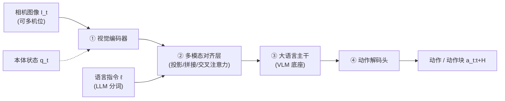

# VLA 理论体系与技术路线笔记

> 定位：从「纯视觉单任务策略」升级到「视觉-语言-动作多模态泛化策略」的理论底座。
> 结合本项目已有结论（PushCube 推立方体、ACT/BC/PPO/IQL/DT 基准、世界模型消融）说明
> VLA 能解决什么、解决不了什么，以及开源路线选型。所有 2026 年现状数据均标注来源链接。

---

## 一、什么是 VLA

**VLA（Vision-Language-Action）模型**：接收相机图像（+ 本体状态）与自然语言指令，
直接输出机器人动作（或动作块）的策略模型。形式化：

```
a_{t:t+H} ~ π_θ( · | I_t^{1..N}, q_t, ℓ )
  I_t^{1..N}: N 路相机图像        q_t: 本体感知（关节/夹爪状态）
  ℓ: 语言指令（分词后编码）       H: 动作块步数（典型 16~50）
```

本质是**把大模型范式搬到控制层**：用互联网级视觉-语言预训练获得的语义先验，
让策略具备「听懂指令 → 在画面中定位目标 → 输出动作」的端到端链路。

### 1.1 VLA 与传统模仿学习（ACT / Diffusion Policy）的本质区别

| 维度 | ACT / Diffusion Policy（本项目已实现） | VLA |
|---|---|---|
| 输入 | 固定机位图像（+ 本体状态），**无语言** | 图像 + 自然语言指令（+ 本体状态） |
| 任务表达 | 隐式：训练数据分布决定"做什么" | 显式：指令语义决定"做什么" |
| 泛化来源 | 数据覆盖（换起点/目标/光照就失效） | 语义对齐 + 预训练先验（指令不变即行为不变） |
| 多任务 | 一个任务一套权重（本项目 ACT 单任务） | 一个模型多任务，靠指令切换 |
| 预训练 | 无（从零/小规模训练） | 互联网级图文预训练 → 机器人数据微调 |
| 典型失败 | 分布外场景（本项目 50 未见场景 0%） | 指令-视觉错位、训练任务外物体属性 |

**本项目自己的证据**（为什么纯视觉路线天花板已现）：
- 专家 ACT 同环境仅 30% 成功率；世界模型想象策略零样本 0%；
- 50 个未见场景泛化测试全部 0%，而**状态输入** IQL 76% / DT 48%——
  差距主要在视觉语义层而非决策层。这正是 VLA「语义对齐」要解决的问题。

### 1.2 VLA 解决不了什么（保持诚实）

- 不消除对**数据质量与覆盖**的依赖：指令里没出现过的物体属性、没微调过的机器人本体照样失败；
- 不替代底层控制：输出仍是末端/关节增量，标定、限位、安全逻辑仍需外层闭环；
- 推理延迟高（7B 级模型单次前向百毫秒级），需要动作块（chunk）+ 缓存观测前缀来摊薄成本；
- 仿真中指令-视觉配对数据要自己构建——这正是本项目下阶段「自定义 VLA 数据集」的工作。

---

## 二、RT-2 核心思想精读（VLA 的起点）

RT-2（Google DeepMind, 2023）确立了「动作即语言」范式，三个关键设计：

1. **复用互联网级 VLM 主干**：在 PaLI-X(55B) / PaLM-E(12B) 上做**联合微调**
   （co-fine-tune）：网络图文问答数据 + 机器人轨迹数据混训。意图是让机器人数据
   「搭便车」于网络知识，而不是从头学视觉语义。
2. **动作表示为语言 token**：把 7 自由度末端动作（3 位移 + 3 轴角旋转 + 1 夹爪）
   每维离散化为 **256 个 bin**，映射成词表中的特殊 token；训练目标仍是标准的
   下一 token 预测交叉熵。于是"控制"变成"生成"。
3. **涌现的语义泛化**：RT-2 论文报告，在未见过的语义推理类指令上成功率约为
   此前 RT-1 的 2 倍（如"把杯子移到能用来冲咖啡的物体旁边"→ 拿起马克杯）——
   网络预训练中的常识直接迁移到了控制行为上。

**对本项目的启示**：我们不用 55B 模型，但「动作离散化为 token / 或用独立动作头」、
「指令与图像联合编码」这两个设计被所有开源 VLA 继承；且「数据里显式写入任务语义
（指令）」是泛化的来源——所以后续采集数据时**必须逐条轨迹配语言标注**。

---

## 三、VLA 通用架构：四段式

所有主流开源 VLA 都可以拆成四段（差别在每段的具体实现）：



文字版（兼容不渲染 Mermaid 的阅读器）：

```
相机图像 I_t ──► ① 视觉编码器 ──┐
本体状态 q_t ─ ─┘（FiLM/拼接注入）│
                                ├─► ② 多模态对齐层 ─► ③ 大语言主干 ─► ④ 动作解码头 ─► 动作块
语言指令 ℓ ──► 分词 embedding ──┘
```

### 3.1 四段式在代表模型中的实例化对照

| 段 | OpenVLA (7B) | π0 / π0.5 (3B) | SmolVLA (450M) | GR00T N1.7 (3B, 人形) |
|---|---|---|---|---|
| ① 视觉编码器 | DINOv2 + SigLIP 双编码器 | SigLIP (PaliGemma 内置) | SigLIP | Eagle/Cosmos 视觉塔 |
| ② 对齐层 | MLP 投影到词表空间 | PaliGemma 原生 | 投影 + 注意力注入 | VLM 原生 |
| ③ 语言主干 | Llama 2 7B | PaliGemma 3B | SmolLM2 (约 360M) | Cosmos-Reason2-2B |
| ④ 动作解码头 | 自回归离散 token（7 维 × 256 bin） | 流匹配动作专家（连续，块 50） | 流匹配动作专家（约 100M，块 50） | 32 层 DiT 扩散头（块 8~16） |
| 语言条件 | 是（指令拼进上下文） | 是 | 是 | 是 |

> 架构上本项目世界模型的 ConvEncoder+RSSM 与 VLA 的 ①③④ 段是不同范式：
> 世界模型学"环境怎么变"，VLA 学"指令下该做什么"；二者可互补（世界模型提供
> 想象数据增强，VLA 提供语义泛化策略）。

---

## 四、开源 VLA 主流路线梳理（2026 现状）

### 4.1 数据底座：Open X-Embodiment（OXE）

Google DeepMind 联合 34 家实验室发布的跨本体机器人数据集与标准（RLDS 格式），
约 100 万+ 真机演示、20+ 种机器人。RT-X、OpenVLA、Octo 等都以其为预训练底座。
**对本项目的意义**：它是"数据格式与基准"层面的公共语言；而本项目实际用
LeRobotDataset 格式管理 PushCube 数据（见 4.3）。

### 4.2 模型路线速览（2026-10 状态，来源见文末）

| 模型 | 维护方 | 参数 | 开源许可 | 动作输出 | 推理显存 | 微调显存(LoRA) | LIBERO 均分* |
|---|---|---|---|---|---|---|---|
| OpenVLA | 斯坦福/伯克利等 | 7.5B | MIT | 离散 token，单步，7自由度 | bf16 约 14GB 起 | >24GB | 76.5 |
| OpenVLA-OFT | 同上 | 7.5B | MIT | 连续 L1 头+并行解码，块 8~25 | 约 16GB | 27~80GB | 97.1 |
| π0 / π0.5 (openpi) | Physical Intelligence | 3B/3.6B | Apache-2.0 | 流匹配，块 50 | >8GB | >22.5GB | 96.85(π0.5) |
| SmolVLA | HuggingFace LeRobot | 450M | Apache-2.0 | 流匹配，块 50 | 消费级 GPU/CPU | 单卡 | 87.3 |
| GR00T N1.7 | NVIDIA | 3B | 代码 Apache-2.0 / 权重 NVIDIA 许可 | 流匹配 DiT，块 8~16 | ≥16GB | ≥40GB | ~97 |
| Octo | UC Berkeley | 93M | 开源 | 扩散头 | 极低 | 极低 | —（前 VLA 基线） |

\* LIBERO 分数为各团队在 LIBERO 微调后自报，仅作量级参考，不构成横向公平对比。

补充事实：
- OpenVLA 训练数据约 97 万条 OXE 演示，是 HuggingFace 下载量最高的机器人模型
  （截至 2026-10 约 28.9 万次/月）；
- Physical Intelligence 更新的 π*0.6 / π0.7 未开源，改为 Pi API（2026-10 起）；
- Gemini Robotics 2 仅对合作伙伴开放；Figure Helix 亦不开源。

### 4.3 生态层：LeRobot（HuggingFace）

本项目 `lerobot` 环境（v0.7.0）已在用的生态，是开源 VLA 的"胶水层"：
- **LeRobotDataset** 统一数据格式（图像/状态/动作/时间戳/episodes，v2/v3 规范），
  本项目 ACT 阶段已将 PushCube 数据格式化为该规范；
- 原生集成策略实现：ACT、Diffusion Policy，以及 **SmolVLA（原生）**、π0/GR00T 移植；
- 兼容低成本遥操硬件（SO-100/SO-101 等），训练-评估-部署一套 API。

> 生态动态（了解即可）：2026-09 NVIDIA 宣布收购 Hugging Face，LeRobot 所在的
> 开源生态归属硬件厂商，后续版本策略值得跟踪。

### 4.4 动作解码三大流派（选型时最重要的技术分叉）

| 流派 | 代表 | 原理 | 优点 | 代价 |
|---|---|---|---|---|
| 自回归离散 token | OpenVLA、π0-FAST | 动作离散成 token 逐个生成 | 与 LLM 完全同构、实现简单 | 解码慢（单步 ~6Hz），离散化损失精度 |
| 流匹配/扩散头 | π0、SmolVLA、GR00T | 小动作专家去噪连续动作块 | 平滑、高频（块 50 @ 最高 50Hz）、精度高 | 训练/推理多一步采样循环 |
| 双系统 | GR00T、Gemini Robotics | 慢思考 VLM（System 2）+ 快动作头（System 1） | 兼顾推理与实时性 | 架构与训练最复杂 |

经验法则（Voxel51 2026-11 总结）：**有开放权重 + 单卡消费级 GPU → 先试 SmolVLA；
要强操纵基线 → openpi（π0/π0.5）LoRA；人形/具身全栈 → GR00T**。

---

## 五、与本项目场景的结合点

**已有资产**：
- PushCube-v0 推立方体环境与采集管线（`mujoco` 环境，EGL 离屏渲染）；
- 200+ 条轨迹的混合数据集（专家 scripted + PPO + 随机），224×224 RGB、4 自由度动作
  [dx, dy, dz, gripper]，已格式化为 LeRobotDataset（`lerobot` 环境 v0.7.0）；
- 纯视觉基准与泛化测试协议（50 场景、IQL/DT/PPO/ACT 统一口径）；
- GPU：RTX A6000 48GB —— OpenVLA 7B bf16 推理（约 14GB）与 π0.5/SmolVLA LoRA
  微调（22~27GB 起）均在预算内。

**选型结论（为下阶段 LoRA 微调）**：
1. **推理链路跑通用 OpenVLA**：下载量最大、文档最全、`vla` 环境可直接加载；
   7B 权重 + 单图 + 指令 → 7 自由度末端增量，能完整验证「图像+语言→动作」全链路；
2. **微调优先 SmolVLA**：LeRobot 原生、450M 单卡可训、数据格式与本项目现有
   LeRobotDataset 一致，适配成本最低；π0.5 作为进阶备选；
3. **数据集改造是核心工作**：现有轨迹**逐条补语言标注**（如"把红色方块推到绿色
   目标区域"），并按指令维度制造变化（目标位置/颜色/方位词），否则语言条件形同虚设。

---

## 六、一百字总结：我的场景为什么需要 VLA

> PushCube 实验里，纯视觉策略换 50 个未见场景成功率 0%，专家 ACT 也仅 30%——
> 它们把任务当固定分布拟合，泛化只能靠数据覆盖。VLA 把"把红方块推到目标"变成
> 语义对齐问题：语言指令显式表达意图，图文预训练带来跨场景先验，同一模型可随
> 指令切换目标与子任务。泛化从"见过"升级为"听懂"，这是纯视觉架构补不上的缺口。

---

## 七、参考资料

- RT-2: https://robotics-transformer2.github.io/ （arXiv:2307.15818）
- OpenVLA: https://openvla.github.io/ （arXiv:2406.09246，仓库 openvla/openvla）
- OpenVLA-OFT: https://github.com/moojink/openvla-oft （arXiv:2502.19645）
- Open X-Embodiment / RT-X: https://robotics-transformer-x.github.io/
- π0 / openpi: https://github.com/Physical-Intelligence/openpi （arXiv:2410.24164）
- SmolVLA: https://huggingface.co/blog/smolvla （arXiv:2506.01844）
- Isaac GR00T N1.x: https://github.com/NVIDIA/Isaac-GR00T
- Octo: https://octo-models.github.io/
- LeRobot: https://github.com/huggingface/lerobot
- 2026 横向对比（现状数据来源）：
  https://voxel51.com/blog/vla-models-compared ；https://presenc.ai/research/best-open-weight-robotics-vla-models-2026
